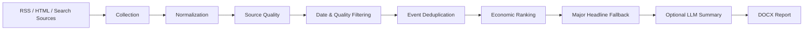

# Economic News Intelligence Pipeline

English version: [README.md](README.md)

这是一个可配置的 Python 经济新闻情报流水线，用于从多类新闻源采集经济与金融相关新闻，统一元数据，进行来源质量控制、日期过滤、质量过滤、事件级去重、经济相关性排序，并在可选情况下调用 LLM 生成中文摘要，最后导出结构化的每日 DOCX 报告。

## 项目概览

这个项目最初来源于实际工作中的每日新闻整理工具，后续逐步重构为更适合公开展示的完整 pipeline。当前实现保留了原始项目的可运行性，同时将整体流程明确表达为：

News Sources
-> Collection
-> Normalization
-> Source Quality Control
-> Date Filtering
-> Quality Filtering
-> Event-level Deduplication
-> Economic Relevance Ranking
-> Major Headline Fallback
-> Optional LLM Summarization
-> DOCX Report

## 功能特点

- 支持 RSS、HTML 列表页、RSS 自动发现页、搜索回退源的多源采集
- 统一发布日期解析，并按目标时区进行过滤
- 基于 YAML 的来源质量分类
- 带有可解释排除原因的优先级过滤
- 多层事件级去重与诊断输出
- 带分项权重的可解释排序
- 对宏观、贸易、商品、政策、科技与重要头条进行优先级建模
- 在最终入选后可选调用 LLM 生成中文摘要
- 内置 LLM 输出校验与回退机制
- 输出每日 DOCX 报告
- 保留 source health、selection、dedupe 等诊断能力
- 当可行时优先把搜索包装链接修正为原站直链

## 架构



## 项目结构

```text
news_agent/
├── config.yaml               # 运行时默认配置、输出路径、付费域名、API 开关
├── config/
│   ├── keywords.yaml         # 关键词与分类策略
│   ├── sources.yaml          # source inventory
│   ├── source_quality.yaml   # 来源分级与 denylist 策略
│   └── thresholds.yaml       # 相似度、排序、选择配额等阈值
├── run_daily_news.py         # CLI 入口
├── src/
│   ├── collect.py            # 采集主编排
│   ├── collect_dates.py      # 日期解析辅助模块
│   ├── collect_http.py       # HTTP fallback 辅助模块
│   ├── dedupe.py             # 多层事件去重
│   ├── links.py              # 链接校验与 URL fallback 修正
│   ├── pipeline_config.py    # 合并仓库配置
│   ├── quality.py            # 日期与质量过滤
│   ├── rank.py               # 打分与最终选择
│   ├── render_docx.py        # DOCX 报告导出
│   ├── source_quality.py     # 来源质量分类
│   ├── summary.py            # 可选 LLM 摘要与校验
│   └── utils.py              # 运行时与通用工具
└── tests/                    # 合成回归测试
```

## 去重策略

当前去重逻辑采用通用、可解释的多层策略，而不是针对某个历史新闻事件写补丁：

1. URL 规范化后完全相同
2. 标题规范化后完全相同
3. 标题高相似度
4. 事件指纹相同
5. 基于标题 token、实体、动作词、发布日期的模糊事件相似度

每条新闻会被标注：

- `normalized_title`
- `strong_entities`
- `action_tokens`
- `event_tokens`
- `event_fingerprint`

因此不仅能去重，还能解释：

- 为什么保留这条
- 为什么另一条被视为重复
- 触发的是哪一层去重规则

## 排序策略

排序综合多个信号，而不是只看关键词命中：

- source quality / source weight
- economic relevance
- market impact
- trade / commodity relevance
- headline importance
- recency
- watchlist bonus
- quality score
- major-headline fallback priority

同时也会施加惩罚项：

- soft news penalty
- stale content penalty
- duplicate penalty
- obvious soft-news penalty

每条新闻会保留分项得分，便于解释最终排序结果。实际选择时，经济与市场相关新闻会优先入选；如果某一栏当天不足，则会使用重要国内/国际头条作为结构化补位。

## 配置设计

项目尽量把“策略参数”和“处理逻辑”拆开：

- `config.yaml`：运行时默认值、输出路径、付费域名规则、API 开关
- `config/keywords.yaml`：采集、质量过滤、排序用关键词
- `config/sources.yaml`：source inventory
- `config/source_quality.yaml`：来源分级、域名规则、denylist
- `config/thresholds.yaml`：相似度阈值、排序惩罚、bucket cap、fallback 阈值

这样修改业务策略时，不必频繁进入核心逻辑文件。

## 运行方式

安装依赖：

```bash
pip install -r requirements.txt
```

创建环境变量：

```bash
cp .env.example .env
```

执行 dry run：

```bash
python run_daily_news.py --dry-run
```

指定日期回补：

```bash
python run_daily_news.py --date 2026-08-09 --dry-run
```

查看 source 诊断：

```bash
python run_daily_news.py --check-sources --date 2026-08-09
python run_daily_news.py --probe-domestic-sources --date 2026-08-09
python run_daily_news.py --probe-international-sources --date 2026-08-09
```

## 可解释诊断

这个项目保留了大量工程化诊断信息，而不是为了“简洁”把它们删掉。

包括但不限于：

- source health check
- target-date count
- selected candidate count
- dedupe report
- exclusion reason
- ranking score breakdown
- source quality
- summary validation

这也是项目公开展示的重要亮点之一：pipeline 的每一步都有解释空间。

## LLM 摘要

LLM 摘要是可选层，且默认关闭，不是核心依赖。

即使没有 API key、没有开启开关、本地模型服务没有启动，或者摘要生成后没有通过校验，collection、filtering、dedupe、ranking、selection 仍然可以正常运行，并回退到 `manual_required`。LLM 只在最终入选新闻之后，用于生成中文摘要。

当前可选摘要后端：

- `openai`：云端 API
- `ollama`：本地运行的 Ollama 模型服务

当前摘要层包含以下校验：

- 语言比例检查
- 长度检查
- 中英混杂检测
- 模板化 / 重复内容检测
- 失败后的再生成回退

示例环境变量：

```bash
# OpenAI
ENABLE_LLM_SUMMARY=true
SUMMARY_PROVIDER=openai
OPENAI_API_KEY=...
SUMMARY_MODEL=gpt-4o-mini

# Ollama
ENABLE_LLM_SUMMARY=true
SUMMARY_PROVIDER=ollama
OLLAMA_MODEL=qwen2.5:7b-instruct
OLLAMA_API_BASE=http://localhost:11434/api/generate
```

## 输出说明

pipeline 会输出每日 DOCX 报告与 JSON 诊断文件。默认情况下，这些运行产物已经通过 `.gitignore` 排除，避免把私有或一次性结果直接提交到公开仓库。

## 已知限制

- 事件去重目前仍以词汇、实体、事件指纹为主。对于措辞差异特别大的同一事件，偶尔仍可能漏过去重。
- 部分新闻源只提供不稳定的时间字段，可能给日期判断带来噪声。
- 搜索回退源的元数据质量通常弱于第一方 RSS。
- 仅靠 HTML 列表页有时无法获得足够稳定的文章级元数据。
- 搜索包装链接不一定总能被还原成原站直链。
- Ollama 这类本地摘要后端需要用户额外启动本地模型服务。

## 后续可改进方向

- 基于 embedding 的语义事件聚类
- 多语言句向量去重
- 更稳健的正文抽取
- 跨天事件追踪
- 来源可靠性学习
- 学习型排序模型
- 更稳健的搜索包装链接解包

## 安全与隐私说明

在推送到 GitHub 之前，不应提交：

- `.env`
- `output/` 中的运行产物
- `logs/`
- 真实业务报告 DOCX
- 本地缓存快照
- 仅供个人机器使用的自动化文件
- 任何凭证、内部 URL、内部资料

仓库已经提供 `.env.example` 和更完整的 `.gitignore`，用于帮助区分公开内容与私有内容。
